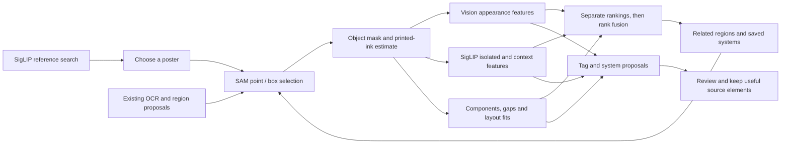

# Source regions, geometry and combined retrieval

PosterLab uses **Apple’s SAM 2.1 Tiny Core ML release** for local point- and box-guided source selection. The model pack is optional, about 80 MB, and is pinned by repository revision and file checksums. The native runtime uses the CPU configuration verified against independent Python/Core ML fixtures. The local Neural Engine path disagreed with that reference, so it is excluded from this release. The GPU path was also measured on an M1: it encodes about twice as fast (0.4 s versus 0.75 s) but loses parity on thin type, with mask IoU 0.86 and 0.95 on two type-box options, so it is not used either.

## How the three layers cooperate



Vision feature prints compare appearance. SigLIP supplies text-aligned meaning and semantic similarity. SAM determines the support region to inspect; it is not a technique classifier. Their feature spaces stay separate, including model, revision, preprocessing and scalar metadata. Equal vector dimensions do not make them interchangeable.

The collection pass reuses compatible, current whole-poster SigLIP features. Existing OCR boxes and region proposals, plus a declared point grid, seed SAM. Each isolated region receives a Vision print, SigLIP features for the isolated image and its original context, and measured geometry. Saved type-system source embeddings and fourteen source-linked shape interpretations provide related-system references. Six shape interpretations were added after [visual review and targeted mask refinement](output/sam-shape-expansion-v1/index.html).

Selected-region retrieval combines **Vision distance, SigLIP cosine and mask-geometry distance using weighted reciprocal-rank fusion**. The weights are 1 / 1 / 0.7 with a rank offset of 60. Raw distances and cosines remain visible. Text-only retrieval uses the semantic ranking. These are retrieval scores, rather than probabilities or aesthetic ratings.

## Select an element in the app

Open **Review library → Elements & styles → Select region…**. Click inside the element, or use the current element bounds. Add foreground marks to include ink and background marks to exclude nearby areas. Coordinates are normalized from the upright image’s top-left corner; numeric fields provide a keyboard alternative. Fourteen marks, including the two box corners, fit this model contract.

Three mask alternatives expose estimated IoU and stability. The poster overlay shows the object mask; the cutout preview shows the recorded ink refinement. **Find related regions** compares the current selection with recorded collection regions using all three rankings and shows their individual ranks. **Use region** adds a source element with its exact source location, masks, prompts, model fingerprints, features and links to overlapping OCR lines. Its technique suggestions stay unconfirmed. Source changes invalidate a pending mask before it can be saved.

The inspector’s **Region analysis** section exposes collection proposals and system candidates. **Refine region…** starts from a proposal’s bounds. Related saved systems are review leads. Reusable vector rules are created after inspecting the candidate’s invariants.

## Object area and printed ink

SAM predicts mask scores on a 256 × 256 grid stretched over the whole poster. Selections keep that grid and its raw scores. Saved regions use SAM's own post-processing instead of the thresholded grid: the scores are upsampled bilinearly to a 1,024-pixel long side at the poster's physical aspect, then thresholded at zero. Edges follow the ink instead of 256-grid steps, and fine repeated strokes, such as concentric rings, no longer alias into fragments. The same interpolation can thin strokes that are one grid cell wide. Masks saved before this change keep their 256 grid.

SAM can select an entire motif, including paper inside outlined type or rings. PosterLab retains that original model mask separately. When the immediately surrounding color is sufficiently consistent, a second, SAM-constrained mask removes the estimated paper color in OKLab. Variable backgrounds retain the original object mask. The method, local spread, threshold and removed fraction are recorded.

Geometry describes those predicted pixels: physical aspect, ink fraction, connected components, enclosed gaps, reflection/quarter-turn agreement and a normalized silhouette. Circular layout fits use component centers in physical image coordinates; residuals are relative to the fitted radius. Contour centers can support concentric-pattern proposals. Component centers and separate region anchors can support grid/repetition proposals.

The collection pass considers all three of SAM's alternatives for every prompt, roughly whole, part and subpart (such as a text block, a word and a letter). Every alternative that passes the IoU and stability gates competes for the retained regions; near-duplicates (mask IoU above 0.88) are dropped.

Besides OCR boxes, region proposals and the point grid, the pass adds up to six **ink seeds** (`--ink-points`, 0 disables them). When one color covers at least 35% of the poster, as printed stock or a full-bleed ground, that color counts as paper. Each sizeable ink component then receives one SAM point on its ink cell nearest its center, so a ring is prompted on its stroke rather than its hole. Photographs and collages have no dominant color and keep the grid alone; about a third of the collection qualifies. On 84 sampled posters, ink seeds gave 23 of 44 previously empty posters regions and raised the regions from 124 to 186, with SAM's quality estimate unchanged. Some added regions on photographic posters describe the photographed scene rather than printed design.

Cross-region candidates require nonoverlapping masks and agreement between Vision, SigLIP and ink geometry. Complete-link grouping rejects similarity chains. Repeated-copy evidence uses normalized OCR text where available. These candidates preserve their actual region IDs, metrics and observed copy. The relationship pass can be rerun on saved features without additional model inference.

Low-resolution masks, photographs, ligatures, outlines and imperfect poster borders limit these measurements. Ink components are not recovered authoring layers or guaranteed glyph identities. Suggested tags and candidate systems require review.

## Setup and commands

Use the Python environment created for SigLIP, or install `coremltools` and `certifi` in an isolated Python environment:

```sh
.build/siglip-venv/bin/python scripts/prepare-sam2.py
./scripts/build.sh
```

The build bundles optional `models/sam2` into the app and standalone CLI. Runtime discovery also accepts `POSTERLAB_SAM2_MODELS` or `--sam-models`. SigLIP continues to use its own model pack and fingerprint.

```sh
./dist/poster library segment --library library --poster POSTER_ID \
  --points '0.5,0.5,1;0.6,0.5,0' --out output/my-selection
./dist/poster library segment --library library --poster POSTER_ID \
  --box '0.2,0.2,0.4,0.4' --out output/my-box-selection
./dist/poster library analyze-regions --library library --grid 2 --max-regions 4 \
  --sam-models models/sam2 --models models/siglip --out output/my-region-study
./dist/poster library region-search --library library \
  --query 'concentric circular line pattern' --out output/region-hits.json
./dist/poster library region-search --library library --region REGION_ID \
  --out output/related-regions.json
./dist/poster library refresh-region-links --library library
```

`--limit` and `--poster` scope an analysis. Completed posters are checkpointed and reused when their image, models, settings, recipe and reviewed labels still match. `--force` rebuilds the scoped analysis. The corpus run is a coarse prompt pass; regions outside those prompts remain available for interactive selection. The process stops before exhausting disk space and resumes with the same command.

## Stored evidence and review protection

- `library/segmentation/posters/ID/analysis.json`: prompts attempted, discarded masks, geometry, tag evidence, system candidates and pipeline revisions.
- `regions/REGION_ID/`: original SAM mask, estimated ink mask, transparent cutout, lossless isolated model input and typed features. The encoded input is decoded before feature extraction, binding the features to saved pixels.
- `library/segmentation/accepted-regions.json`: explicitly accepted regions available to combined retrieval.
- `library/segmentation/run.json`: checkpoint counts and failures.
- `library/reviews/region-enrichment/`: pre-enrichment records. Accepted selections also retain an individual record backup.

Automated enrichment adds `suggested` tags with zero confidence, explicitly denoting uncalibrated evidence. It preserves confirmed/rejected labels, border coordinates, review state, style votes and source genomes. It never creates a confirmed training label. Explicit technique review feeds the existing reviewed-label training workflow. New taxonomy terms describe symmetry, concentric contours, counterforms, modular tiles and curved line fields.

`poster-checks --segmentation-only` verifies the optional real-model integration. Generate its independent fixtures with `scripts/check-sam2-pack.py`. Checks cover exact native/reference masks, image-encoding reuse, topology/layout fits, three-signal rank fusion, feature-space rejection, cache reuse, empty results, accepted-mask provenance, label protection and stale-input rejection.

Sources: [Apple’s pinned Core ML model](https://huggingface.co/apple/coreml-sam2.1-tiny/tree/39ae0a8a83e5e6cd196e804bf7cccc5f8171f306), [SAM 2 upstream](https://github.com/facebookresearch/sam2), [conversion implementation](https://github.com/huggingface/segment-anything-2/tree/coreml-conversion). The model card and upstream license ship with the downloaded pack.
